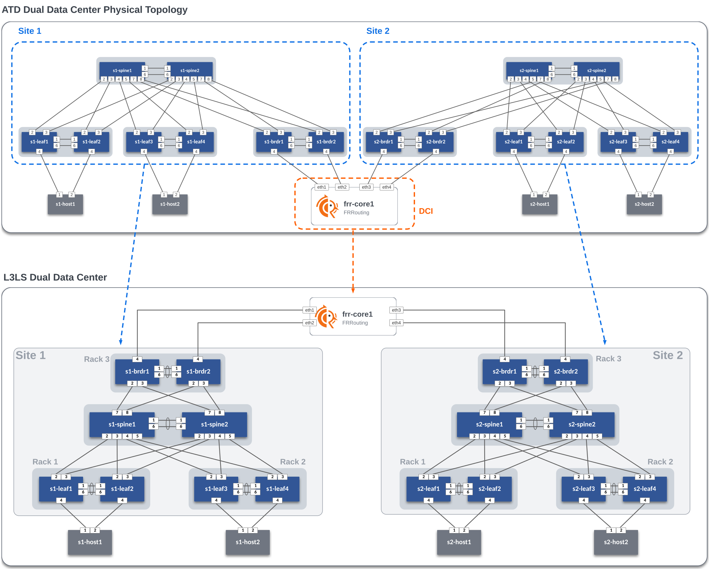
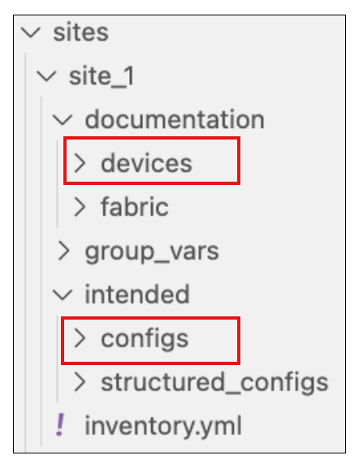

# Initial Deployment - Day 0

## AVD Lab Guide Overview

The AVD Lab Guide is a follow-along set of instructions to deploy a dual data center L3LS EVPN VXLAN fabric design. The data model overview and details can be found [here](README.md). In the following steps, we will explore updating the data models to add services, ports, and DCI links to our fabrics and test traffic between sites.

In this example, the lab is used to create the L3LS Dual Data Center topology below. We will build and deploy configurations for Site 1 and Site 2 (blue areas) with AVD, then generate FRR's own structured configuration and provision the FRR node in the DCI Network cloud (orange area).



### Host Addresses

| Host     |  IP Address  |
|:--------:|:------------:|
| s1-host1 | 10.10.10.100 |
| s1-host2 | 10.20.20.100 |
| s2-host1 | 10.10.10.200 |
| s2-host2 | 10.20.20.200 |

## Step 1 - Initialize Git

We will start by opening a new terminal.

To open the integrated terminal:

1. <kbd>Ctrl</kbd> + <kbd>Shift</kbd> + <kbd>`</kbd> on Windows
2. <kbd>Ctrl</kbd> + <kbd>Shift</kbd> + <kbd>`</kbd> on Mac.

Initialize Git and configure your global Git settings.

```bash
git init -b main
```

``` bash
git config --global user.name "FirstName LastName"
```

``` bash
git config --global user.email "name@example.com"
```

### Validate Pre-configured Hosts

The host nodes are preconfigured on lab startup. FRR starts with a minimal configuration and is provisioned in Step 5. You can verify the host configuration by connecting to host1 and viewing its baseline configuration.

The border leaves connect to `frr-core1` over routed point-to-point links. The hosts (two per site) have port-channels to the leaf pairs and are pre-configured with an IP address and route to reach the other hosts.

The preconfigured hosts are outside the Ansible inventories. Build, deployment,
and validation commands target each site's fabric group. User-defined ANTA
reachability tests run from leaf SVIs in the `OVERLAY` VRF to check the host
attachments after the services and host-facing ports are enabled.

```text
ssh arista@s1-host1
show ip interface brief 
```

```text
ssh arista@s1-host1
s1-host1#show ip int b
                                                                                       Address
Interface           IP Address            Status       Protocol                 MTU    Owner
------------------- --------------------- ------------ -------------------- ---------- -------
Management1         192.168.0.16/24       up           up                      1500
Port-Channel1       10.10.10.100/24       down         lowerlayerdown          1500

```

> Exit from the ssh session before continuing

## Step 2 - Deployment Overview

This section will review and update the existing L3LS data model. We will add features to enable VLANs, SVIs, connected endpoints, and P2P links to the DCI Network. After the lab, you will have enabled an L3LS EVPN VXLAN dual data center network through automation with AVD. YAML data models and Ansible playbooks will be used to generate EOS CLI configurations and deploy them to each site. We will start by focusing on building out Site 1 and then repeat similar steps for Site 2. Then, we will enable connectivity to the DCI Network to allow traffic to pass between sites. Finally, we will enable EVPN gateway functionality on the border leafs.

### Summary of Steps

- Build and Deploy `Site 1`
- Build and Deploy `Site 2`
- Connect sites to DCI Network
- Verify routing
- Enable EVPN gateway functionality
- Test traffic

## Step 3 - Site 1

### Build and Deploy Initial Fabric

The initial fabric data model key/value pairs have been pre-populated in the following group_vars files in the `sites/site_1/group_vars/` directory.

- SITE1_CONNECTED_ENDPOINTS.yml
- SITE1_NETWORK_SERVICES.yml
- SITE1_FABRIC.yml
- SITE1_LEAFS.yml
- SITE1_SPINES.yml

Review these files to understand how they relate to the topology above.

At this point, we can build our initial configurations for the topology.

``` bash
make build-site-1
```

> Run `git add` and `git commit` to create a snapshot of the current build state. This will help you view the differences between steps in the workshop.

``` bash
git add .
git commit -m "saving snapshot"
```

AVD creates a separate markdown and EOS configuration file per switch. In addition, you can review the files in the `documentation` and `intended` folders per site.



Now, deploy the configurations to Site 1 switches.

``` bash
make deploy-site-1
```

#### Verification

Now, let's log in to some switches to verify the current configs (`show run`) match the ones created in the `intended/configs` folder. We can also check the current state for MLAG, interfaces, BGP peerings for IPv4 underlay, and BGP EVPN overlay peerings.

You can connect to devices by running `ssh arista@s1-leaf1` or entering `s1-leaf1` directly from the terminal.

These outputs were taken from `s1-leaf1`:

1. Check MLAG status.

    **Command**

    ``` text
    show mlag
    ```

    **Expected Output**

    ``` text
    s1-leaf1#show mlag
    MLAG Configuration:
    domain-id                          :            S1_RACK1
    local-interface                    :            Vlan4094
    peer-address                       :          10.251.1.1
    peer-link                          :       Port-Channel1
    hb-peer-address                    :             0.0.0.0
    peer-config                        :          consistent

    MLAG Status:
    state                              :              Active
    negotiation status                 :           Connected
    peer-link status                   :                  Up
    local-int status                   :                  Up
    system-id                          :   02:1c:73:c0:c6:12
    dual-primary detection             :            Disabled
    dual-primary interface errdisabled :               False

    MLAG Ports:
    Disabled                           :                   0
    Configured                         :                   0
    Inactive                           :                   0
    Active-partial                     :                   0
    Active-full                        :                   0
    ```

2. Check routed interface configurations.

    **Command**

    ``` text
    show ip interface brief
    ```

    **Expected Output**

    ``` text
    s1-leaf1#show ip interface brief
                                                                                    Address
    Interface         IP Address            Status       Protocol            MTU    Owner
    ----------------- --------------------- ------------ -------------- ----------- -------
    Ethernet2         172.16.1.1/31         up           up                 1500
    Ethernet3         172.16.1.3/31         up           up                 1500
    Loopback0         10.250.1.3/32         up           up                65535
    Loopback1         10.255.1.3/32         up           up                65535
    Management1       192.168.0.12/24       up           up                 1500
    Vlan4093          10.252.1.0/31         up           up                 1500
    Vlan4094          10.251.1.0/31         up           up                 1500
    ```

3. Check eBGP/iBGP peerings for IPv4 underlay routing.

    **Commands**

    ``` text
    show ip bgp summary
    ```

    **Expected Output**

    ``` text
    s1-leaf1#show ip bgp summary
    BGP summary information for VRF default
    Router identifier 10.250.1.3, local AS number 65101
    Neighbor Status Codes: m - Under maintenance
      Description              Neighbor   V AS           MsgRcvd   MsgSent  InQ OutQ  Up/Down State   PfxRcd PfxAcc PfxAdv
      s1-leaf2_Vlan4093        10.252.1.1 4 65101             10        10    0    0 00:01:41 Estab   10     10     10
      s1-spine1_Ethernet2      172.16.1.0 4 65100             12        13    0    0 00:01:46 Estab   7      7      10
      s1-spine2_Ethernet2      172.16.1.2 4 65100             12         9    0    0 00:01:46 Estab   7      7      4
    ```

4. Check eBGP/iBGP peerings for the EVPN overlay.

    **Commands**

    ``` text
    show bgp evpn summary
    ```

    **Expected Output**

    ``` text
    s1-leaf1#show bgp evpn summary
    BGP summary information for VRF default
    Router identifier 10.250.1.3, local AS number 65101
    Neighbor Status Codes: m - Under maintenance
      Description              Neighbor   V AS           MsgRcvd   MsgSent  InQ OutQ  Up/Down State   PfxRcd PfxAcc PfxAdv
      s1-spine1_Loopback0      10.250.1.1 4 65100              7         7    0    0 00:02:35 Estab   0      0      0
      s1-spine2_Loopback0      10.250.1.2 4 65100              7         6    0    0 00:02:36 Estab   0      0      0
    ```

    > The basic fabric with MLAG peers, P2P routed links between leaf nodes and spines, eBGP/iBGP IPv4 underlay peerings, and eBGP/iBGP EVPN overlay peerings is now created. Next up, we will add VLAN and SVI services to the fabric.

### Add Services to the Fabric

The next step is to add VLANs and SVIs to the fabric. The services data model file `SITE1_NETWORK_SERVICES.yml` is pre-populated with VLANs and SVIs `10` and `20` in the **OVERLAY** VRF.

Open [SITE1_NETWORK_SERVICES.yml](sites/site_1/group_vars/SITE1_NETWORK_SERVICES.yml) and uncomment lines 1-16, then run the build & deploy process again.

> In VS Code, you can toggle comments on/off by selecting the text and pressing <kbd>Ctrl</kbd> + <kbd>/</kbd> or  <kbd>Cmd</kbd> + <kbd>/</kbd>.

**Build the Configs**

``` text
make build-site-1
```

**Deploy the Configs**

``` text
make deploy-site-1
```

#### Verification

Now lets go back to node `s1-leaf1` and verify the new SVIs exist. Check their IP addresses, any changes to the EVPN overlay and corresponding VXLAN configurations, as well as the EVPN control-plane now that we have some layer 3 data interfaces.

1. Verify VLAN SVIs **10** and **20** exist.

    **Command**

    ``` text
    show ip interface brief
    ```

    **Expected Output**

    ``` text
    s1-leaf1#show ip int b
                                                                                    Address
    Interface         IP Address            Status       Protocol            MTU    Owner
    ----------------- --------------------- ------------ -------------- ----------- -------
    Ethernet2         172.16.1.1/31         up           up                 1500
    Ethernet3         172.16.1.3/31         up           up                 1500
    Loopback0         10.250.1.3/32         up           up                65535
    Loopback1         10.255.1.3/32         up           up                65535
    Management1       192.168.0.12/24       up           up                 1500
    Vlan10            10.10.10.1/24         up           up                 1500
    Vlan20            10.20.20.1/24         up           up                 1500
    Vlan3009          10.252.1.0/31         up           up                 1500
    Vlan4093          10.252.1.0/31         up           up                 1500
    Vlan4094          10.251.1.0/31         up           up                 1500
    Vlan4097          unassigned            up           up                 9164
    ```

    > You should notice some VLANs that we didn't define anywhere in the `SITE1_NETWORK_SERVICES.yml` data model which aren't related to **MLAG**. The additional VLANs will be used for underlay and overlay MLAG peering.

2. Overlay vrf BGP Peering

    **Command**

    ``` text
    show ip bgp summary vrf OVERLAY
    ```

    **Expected Output**

    ``` text
    s1-leaf1#show ip bgp summary vrf OVERLAY
    BGP summary information for VRF OVERLAY
    Router identifier 10.250.1.3, local AS number 65101
    Neighbor Status Codes: m - Under maintenance
      Description              Neighbor   V AS           MsgRcvd   MsgSent  InQ OutQ  Up/Down State   PfxRcd PfxAcc PfxAdv
      s1-leaf2_Vlan3009        10.252.1.1 4 65101              7         7    0    0 00:02:37 Estab   2      2      2
    ```

3. Verify VLANs **10** and **20**, and vrf **OVERLAY** are now mapped to the appropriate VNIs under the `vxlan1` interface.

    **Command**

    ```text
    show run interface vxlan 1
    ```

    **Expected Output**

      ```text
      s1-leaf1#show run int vxlan 1
      interface Vxlan1
        description s1-leaf1_VTEP
        vxlan source-interface Loopback1
        vxlan virtual-router encapsulation mac-address mlag-system-id
        vxlan udp-port 4789
        vxlan vlan 10 vni 10010
        vxlan vlan 20 vni 10020
        vxlan vrf OVERLAY vni 10
      ```

4. Verify we are flooding to the correct remote VTEPs based on what we have learned across the EVPN overlay.

    **Command**

    ```text
    ```

    **Expected Output**

    ```text
    s1-leaf1#show interfaces vxlan 1
    Vxlan1 is up, line protocol is up (connected)
      Hardware is Vxlan
      Description: s1-leaf1_VTEP
      Source interface is Loopback1 and is active with 10.255.1.3
      Listening on UDP port 4789
      Replication/Flood Mode is headend with Flood List Source: EVPN
      Remote MAC learning via EVPN
      VNI mapping to VLANs
      Static VLAN to VNI mapping is
        [10, 10010]       [20, 10020]
      Dynamic VLAN to VNI mapping for 'evpn' is
        [4097, 10]
      Note: All Dynamic VLANs used by VCS are internal VLANs.
            Use 'show vxlan vni' for details.
      Static VRF to VNI mapping is
      [OVERLAY, 10]
      Headend replication flood vtep list is:
        10 10.255.1.7      10.255.1.5
        20 10.255.1.7      10.255.1.5
      MLAG Shared Router MAC is 021c.7301.2391
    ```

5. Finally, lets verify we have **IMET** routes for each VLAN and VTEP in the EVPN overlay. IMET (Type-3) routes are required for Broadcast, Unknown Unicast and Multicast (BUM) traffic delivery across EVPN networks.

    **Command**

    ```text
    show bgp evpn route-type imet
    ```

    **Expected Output**

    ```text
    s1-leaf1#show bgp evpn route-type imet
    BGP routing table information for VRF default
    Router identifier 10.250.1.3, local AS number 65101
    Route status codes: * - valid, > - active, S - Stale, E - ECMP head, e - ECMP
                        c - Contributing to ECMP, % - Pending best path selection
    Origin codes: i - IGP, e - EGP, ? - incomplete
    AS Path Attributes: Or-ID - Originator ID, C-LST - Cluster List, LL Nexthop - Link Local Nexthop

                Network                Next Hop              Metric  LocPref Weight  Path
    * >        RD: 10.250.1.3:10010 imet 10.255.1.3
                                      -                     -       -       0       i
    * >        RD: 10.250.1.3:10020 imet 10.255.1.3
                                      -                     -       -       0       i
    * >Ec      RD: 10.250.1.5:10010 imet 10.255.1.5
                                      10.255.1.5            -       100     0       65100 65102 i
    *  ec      RD: 10.250.1.5:10010 imet 10.255.1.5
                                      10.255.1.5            -       100     0       65100 65102 i
    * >Ec      RD: 10.250.1.5:10020 imet 10.255.1.5
                                      10.255.1.5            -       100     0       65100 65102 i
    *  ec      RD: 10.250.1.5:10020 imet 10.255.1.5
                                      10.255.1.5            -       100     0       65100 65102 i
    * >Ec      RD: 10.250.1.6:10010 imet 10.255.1.5
                                      10.255.1.5            -       100     0       65100 65102 i
    *  ec      RD: 10.250.1.6:10010 imet 10.255.1.5
                                      10.255.1.5            -       100     0       65100 65102 i
    * >Ec      RD: 10.250.1.6:10020 imet 10.255.1.5
                                      10.255.1.5            -       100     0       65100 65102 i
    *  ec      RD: 10.250.1.6:10020 imet 10.255.1.5
                                      10.255.1.5            -       100     0       65100 65102 i
    * >Ec      RD: 10.250.1.7:10010 imet 10.255.1.7
                                      10.255.1.7            -       100     0       65100 65103 i
    *  ec      RD: 10.250.1.7:10010 imet 10.255.1.7
                                      10.255.1.7            -       100     0       65100 65103 i
    * >Ec      RD: 10.250.1.7:10020 imet 10.255.1.7
                                      10.255.1.7            -       100     0       65100 65103 i
    *  ec      RD: 10.250.1.7:10020 imet 10.255.1.7
                                      10.255.1.7            -       100     0       65100 65103 i
    * >Ec      RD: 10.250.1.8:10010 imet 10.255.1.7
                                      10.255.1.7            -       100     0       65100 65103 i
    *  ec      RD: 10.250.1.8:10010 imet 10.255.1.7
                                      10.255.1.7            -       100     0       65100 65103 i
    * >Ec      RD: 10.250.1.8:10020 imet 10.255.1.7
                                      10.255.1.7            -       100     0       65100 65103 i
    *  ec      RD: 10.250.1.8:10020 imet 10.255.1.7
                                      10.255.1.7            -       100     0       65100 65103 i
    ```

You can verify the recent configuration session was created.

When the configuration is applied via a configuration session, EOS will create a "checkpoint" of the configuration. This checkpoint is a snapshot of the device's running configuration as it was **prior** to the configuration session being committed.

``` text
show clock
```

``` text
show configuration sessions detail
```

List the recent checkpoints.

``` text
show configuration checkpoints
```

View the contents of the latest checkpoint file.

``` text
more checkpoint:< filename >
```

See the difference between the running config and the latest checkpoint file.

> This will show the differences between the current device configuration and the configuration before we did our `make deploy` command.

``` text
diff checkpoint:< filename > running-config
```

```text
s1-leaf1#diff checkpoint:99f27a1 running-config
--- checkpoint:99f27a1
+++ system:/running-config
@@ -30,6 +30,16 @@
    unsupported speed action error
    unsupported error-correction action error
 !
+vlan 10
+   name Ten
+!
+vlan 20
+   name Twenty
+!
+vlan 3009
+   name MLAG_L3_VRF_OVERLAY
+   trunk group MLAG
+!
 vlan 4093
    name MLAG_L3
    trunk group MLAG
...
<redacted>
...
+   vrf OVERLAY
+      rd 10.250.1.3:10
+      route-target import evpn 10:10
+      route-target export evpn 10:10
+      router-id 10.250.1.3
+      neighbor 10.252.1.1 peer group MLAG-IPv4-UNDERLAY-PEER
+      neighbor 10.252.1.1 description s1-leaf2_Vlan3009
+      redistribute connected route-map RM-CONN-2-BGP-VRFS
 !
 end
```

### Add Ports for Hosts

Let's configure port-channels to our hosts (`s1-host1` and `s1-host2`).

Open [SITE1_CONNECTED_ENDPOINTS.yml](sites/site_1/group_vars/SITE1_CONNECTED_ENDPOINTS.yml) and uncomment lines 17-45, then run the build & deploy process again.

``` bash
make build-site-1
```

``` bash
make deploy-site-1
```

At this point, hosts should be able to ping each other across the fabric.

```text
s1-host1#show ip interface brief
                                                                                 Address
Interface           IP Address            Status       Protocol           MTU    Owner
------------------- --------------------- ------------ -------------- ---------- -------
Management1         192.168.0.16/24       up           up                1500
Port-Channel1       10.10.10.100/24       up           up                1500
```

From `s1-host1`, run a ping to `s1-host2`.

``` text
ping 10.20.20.100
```

``` text
PING 10.20.20.100 (10.20.20.100) 72(100) bytes of data.
80 bytes from 10.20.20.100: icmp_seq=1 ttl=63 time=30.2 ms
80 bytes from 10.20.20.100: icmp_seq=2 ttl=63 time=29.5 ms
80 bytes from 10.20.20.100: icmp_seq=3 ttl=63 time=28.8 ms
80 bytes from 10.20.20.100: icmp_seq=4 ttl=63 time=24.8 ms
80 bytes from 10.20.20.100: icmp_seq=5 ttl=63 time=26.2 ms
```

### Validate Site 1 with ANTA

Run the validation playbook after deploying the services and host-facing ports.
It combines tests generated from the AVD structured configurations with the
user-defined catalog in
[sites/site_1/anta/user_catalogs/reachability.yml](sites/site_1/anta/user_catalogs/reachability.yml):

```yaml
anta.tests.connectivity:
  - VerifyReachability:
      filters:
        tags: [s1-leaf1]
      hosts:
        - destination: 10.10.10.100
          source: Vlan10
          vrf: OVERLAY
          repeat: 5
  - VerifyReachability:
      filters:
        tags: [s1-leaf3]
      hosts:
        - destination: 10.20.20.100
          source: Vlan20
          vrf: OVERLAY
          repeat: 5
```

The hostname tags select the leaf that originates each probe. These tests check
reachability from `s1-leaf1` to `s1-host1` and from `s1-leaf3` to `s1-host2` in
their respective VLANs. The host-to-host ping above checks inter-VLAN routing.

From the lab directory, run:

```bash
make validate-site-1
```

Review `sites/site_1/anta/reports/anta_report.md`, or the CSV and JSON reports in
the same directory. The Markdown report expands individual checks. Confirm that
both custom probes ran and received all five replies, alongside the generated
fabric tests. Allow ARP and MAC learning to settle before the measured run.

> Site 1 fabric is now complete.

## Step 4 - Site 2

Repeat the previous three steps for Site 2.

- Add Services
- Add Ports
- Build and Deploy Configs
- Verify ping traffic between hosts `s2-host1` and `s2-host2` (10.20.20.200)

For equivalent custom tests in Site 2, copy the Site 1 reachability catalog to
`sites/site_2/anta/user_catalogs/reachability.yml`, creating the directory if
needed. Update the hostname tags and destinations as follows:

| Originating leaf tag | Source SVI | VRF | Destination |
| -------------------- | ---------- | --- | ----------- |
| s2-leaf1 | Vlan10 | OVERLAY | 10.10.10.200 (s2-host1) |
| s2-leaf3 | Vlan20 | OVERLAY | 10.20.20.200 (s2-host2) |

Run the generated fabric tests and the Site 2 custom probes:

```bash
make validate-site-2
```

Review `sites/site_2/anta/reports/anta_report.md` for the expanded results.
Site 2 has no user-defined catalog until you add it; the generated tests still run.

At this point, you should be able to ping between hosts within a site but not between sites. For this, we need to build connectivity to the `DCI Network`. This is covered in the next section.

## Step 5 - Connect Sites to DCI Network

The `frr-core1` node provides DCI transport and demonstrates interoperability
between FRRouting and Arista EOS. Configure the border handoffs with AVD, then
use the `CORE` inventory to generate FRR's own AVD structured configuration and
render its FRR configuration. Each border uses `Ethernet4`; FRR uses `eth1`
through `eth4` and AS 65000.

### Enable the border handoffs

Enable the `l3_edge` block in
[global_dc_vars.yml](global_vars/global_dc_vars.yml), uncommenting it if needed.
The completed block should match the example below. The /31 pool and link IDs
let AVD allocate addresses for both the borders and FRR.
The explicit `routing_protocol: ebgp` keeps these handoffs numbered IPv4 when
RFC 5549 is enabled inside the fabrics.

```yaml
l3_edge:
  p2p_links_ip_pools:
    - name: DCI
      ipv4_pool: 172.16.255.0/24
      prefix_size: 31
  p2p_links_profiles:
    - name: DCI
      ip_pool: DCI
      include_in_underlay_protocol: true
      routing_protocol: ebgp
      mtu: 1500
      bfd: true
  p2p_links:
    - id: 1
      nodes: [ s1-brdr1, frr-core1 ]
      interfaces: [ Ethernet4, eth1 ]
      as: [ 65103, 65000 ]
      profile: DCI
    - id: 2
      nodes: [ s1-brdr2, frr-core1 ]
      interfaces: [ Ethernet4, eth2 ]
      as: [ 65103, 65000 ]
      profile: DCI
    - id: 3
      nodes: [ s2-brdr1, frr-core1 ]
      interfaces: [ Ethernet4, eth3 ]
      as: [ 65203, 65000 ]
      profile: DCI
    - id: 4
      nodes: [ s2-brdr2, frr-core1 ]
      interfaces: [ Ethernet4, eth4 ]
      as: [ 65203, 65000 ]
      profile: DCI
```

The `as` list follows the order in `nodes`: the border ASN comes first and
FRR's ASN comes second. `include_in_underlay_protocol: true` adds the eBGP
neighbor to the existing IPv4 underlay peer group, including its authentication.
The FRR template reads its peer-group password and neighbor BFD settings from
FRR's structured configuration.

### Build and deploy both sites

```bash
make build-site-1 build-site-2
```

Review the four generated border configurations under each site's
`intended/configs/` directory. Each border should have a routed Ethernet4
interface and an IPv4 BGP neighbor in AS 65000. Then deploy:

```bash
make deploy-site-1 deploy-site-2
```

### Build and provision FRR

Build FRR using [its inventory](sites/core/frr-inv.yml) and
[node definition](sites/core/group_vars/CORE.yml). The shared `l3_edge`
inputs describe FRR's links to both sites:

```bash
make build-frr
```

Open [the Jinja template](templates/frr.conf.j2) and compare it with
`sites/core/intended/structured_configs/frr-core1.yml` and the generated
`sites/core/intended/configs/frr-core1.cfg`. FRR's `eth1` address
`172.16.255.1/31` comes from `ethernet_interfaces`, and neighbor `172.16.255.0`
in AS 65103 comes from `router_bgp.neighbors`. Its router ID `10.251.1.1`,
four ECMP paths, authentication, and BFD settings also come from this data.

The template configures `Loopback0` on Linux `lo`. It omits prefix lists, route
maps, and connected redistribution, and uses `no bgp ebgp-requires-policy` to
allow eligible IPv4 routes to pass between the borders. FRR's own loopback is
not advertised into BGP.

After reviewing the generated file, apply it to the running container:

```bash
make deploy-frr
```

The playbook uses `ansible.builtin.copy` over the Docker connection as `root`
inside the container to install the reviewed `.cfg` file at `/etc/frr/frr.conf`.

A handler applies configuration changes with
`/usr/lib/frr/frr-reload.py --reload /etc/frr/frr.conf`. This updates the running
configuration and removes obsolete settings. The file is already at FRR's
startup path; a separate `write memory` is unnecessary and would only save the
running configuration.

### Verify the multivendor underlay

On the Containerlab host, check FRR:

```bash
docker exec frr-core1 vtysh -c 'show bgp ipv4 unicast summary'
docker exec frr-core1 vtysh -c 'show ip route bgp'
docker exec frr-core1 vtysh -c 'show bfd peers'
```

Expect four established BGP sessions and routes to the border loopbacks.
From `s1-brdr1`, check the other side of the BGP session and remote gateway
reachability:

```text
show ip bgp summary
show ip route 10.250.2.7
ping 10.250.2.7 source Loopback0
```

The FRR neighbor on `s1-brdr1` is `172.16.255.1` in AS 65000. On FRR, the
same session has neighbor `172.16.255.0` in AS 65103. Compare the EOS and FRR
configuration syntax: the protocol and addressing must agree on both sides.

The transport path is now in place. Next, enable EVPN peering between the
Arista borders to carry tenant traffic.

## Step 6 - Enable EVPN Gateway Functionality

Uncomment the `evpn_gateway` definitions on the border node groups and
individual border nodes in
[SITE1_FABRIC.yml](sites/site_1/group_vars/SITE1_FABRIC.yml) and
[SITE2_FABRIC.yml](sites/site_2/group_vars/SITE2_FABRIC.yml). The completed
sections should match the following snippets. Remote EVPN peers use Loopback0
addresses; VXLAN tunnel sources use separate loopback addresses.

**SITE1_FABRIC.yml**

``` yaml
- group: S1_BRDR
  bgp_as: 65103
  evpn_gateway:
    evpn_l2:
      enabled: true
    evpn_l3:
      enabled: true
      inter_domain: true
  nodes:
    - name: s1-brdr1
      id: 5
      mgmt_ip: 192.168.0.100/24
      uplink_switch_interfaces: [ Ethernet7, Ethernet7 ]
      evpn_gateway:
        remote_peers:
          - hostname: s2-brdr1
            bgp_as: 65203
            ip_address: 10.250.2.7
    - name: s1-brdr2
      id: 6
      mgmt_ip: 192.168.0.101/24
      uplink_switch_interfaces: [ Ethernet8, Ethernet8 ]
      evpn_gateway:
        remote_peers:
          - hostname: s2-brdr2
            bgp_as: 65203
            ip_address: 10.250.2.8
```

**SITE2_FABRIC.yml**

``` yaml
- group: S2_BRDR
  bgp_as: 65203
  evpn_gateway:
    evpn_l2:
      enabled: true
    evpn_l3:
      enabled: true
      inter_domain: true
  nodes:
    - name: s2-brdr1
      id: 5
      mgmt_ip: 192.168.0.200/24
      uplink_switch_interfaces: [ Ethernet7, Ethernet7 ]
      evpn_gateway:
        remote_peers:
          - hostname: s1-brdr1
            bgp_as: 65103
            ip_address: 10.250.1.7
    - name: s2-brdr2
      id: 6
      mgmt_ip: 192.168.0.201/24
      uplink_switch_interfaces: [ Ethernet8, Ethernet8 ]
      evpn_gateway:
        remote_peers:
          - hostname: s1-brdr2
            bgp_as: 65103
            ip_address: 10.250.1.8
```

> If deploying a multi-site fabric with AVD, and using a single inventory file to contain all sites, the **evpn_gateway/remote_peers** variables for `bgp_as` and `ip_address` do **NOT** need to be populated. Since AVD will know about all these nodes from the single inventory file, it will know those variables and be able to use them to render the configuration.  Since we have split the sites for complexity's sake, we do have to define them here.

### Build and Deploy Changes for EVPN Gateway Functionality

``` bash
make all
```

`make all` builds both AVD fabrics and FRR, then deploys their configurations.
FRR deployment uses its own rendered configuration and connects through Docker.
Use this command against the running lab after reviewing the intended changes.

### Verification

Now lets check and make sure the correct configurations were built and applied, and the EVPN gateways are functioning.

From nodes `s1-brdr1` and `s1-brdr2`, we can check the following show commands.

1. Verify the new BGP configurations were rendered and applied for the remote gateways.

    **Command**

    ``` text
    show run section bgp
    ```

    Look for the below new configurations relevant to the EVPN gateways.

    **s1-brdr1**

    ``` text
    router bgp 65103
      ...
      neighbor EVPN-OVERLAY-CORE peer group
      neighbor EVPN-OVERLAY-CORE update-source Loopback0
      neighbor EVPN-OVERLAY-CORE bfd
      neighbor EVPN-OVERLAY-CORE ebgp-multihop 15
      neighbor EVPN-OVERLAY-CORE send-community
      neighbor EVPN-OVERLAY-CORE maximum-routes 0
      ...
      neighbor 10.250.2.7 peer group EVPN-OVERLAY-CORE
      neighbor 10.250.2.7 remote-as 65203
      neighbor 10.250.2.7 description s2-brdr1
      ...
      vlan 10
          ...
          route-target import export evpn domain remote 10010:10010
          ...
      !
      vlan 20
          ...
          route-target import export evpn domain remote 10020:10020
          ...
      !
      address-family evpn
          neighbor EVPN-OVERLAY-CORE activate
          neighbor EVPN-OVERLAY-CORE domain remote
          ...
          neighbor default next-hop-self received-evpn-routes route-type ip-prefix inter-domain
    ```

    **s1-brdr2**

    ``` text
    router bgp 65103
      ...
      neighbor EVPN-OVERLAY-CORE peer group
      neighbor EVPN-OVERLAY-CORE update-source Loopback0
      neighbor EVPN-OVERLAY-CORE bfd
      neighbor EVPN-OVERLAY-CORE ebgp-multihop 15
      neighbor EVPN-OVERLAY-CORE send-community
      neighbor EVPN-OVERLAY-CORE maximum-routes 0
      ...
      neighbor 10.250.2.8 peer group EVPN-OVERLAY-CORE
      neighbor 10.250.2.8 remote-as 65203
      neighbor 10.250.2.8 description s2-brdr2
      ...
      vlan 10
          ...
          route-target import export evpn domain remote 10010:10010
          ...
      !
      vlan 20
          ...
          route-target import export evpn domain remote 10020:10020
          ...
      !
      address-family evpn
          neighbor EVPN-OVERLAY-CORE activate
          neighbor EVPN-OVERLAY-CORE domain remote
          ...
          neighbor default next-hop-self received-evpn-routes route-type ip-prefix inter-domain
    ```

2. Verify the EVPN overlay peerings to Site 2.

    **Command**

    ``` text
    show bgp evpn summary
    ```

    Look for the peerings to the corresponding Site 2 node.

    **s1-brdr1**

    ``` text
    s1-brdr1#show bgp evpn summ
    BGP summary information for VRF default
    Router identifier 10.250.1.7, local AS number 65103
    Neighbor Status Codes: m - Under maintenance
      Description              Neighbor   V AS           MsgRcvd   MsgSent  InQ OutQ  Up/Down State   PfxRcd PfxAcc
      s1-spine1                10.250.1.1 4 65100            151       150    0    0 01:37:10 Estab   20     20
      s1-spine2                10.250.1.2 4 65100            152       151    0    0 01:37:11 Estab   20     20
      s2-brdr1                 10.250.2.7 4 65203             14        14    0    0 00:00:08 Estab   19     19
    ```

    **s1-brdr2**

    ``` text
    s1-brdr2#show bgp evpn summary
    BGP summary information for VRF default
    Router identifier 10.250.1.8, local AS number 65103
    Neighbor Status Codes: m - Under maintenance
      Description              Neighbor   V AS           MsgRcvd   MsgSent  InQ OutQ  Up/Down State   PfxRcd PfxAcc
      s1-spine1                10.250.1.1 4 65100            158       152    0    0 01:38:37 Estab   20     20
      s1-spine2                10.250.1.2 4 65100            156       147    0    0 01:38:37 Estab   20     20
      s2-brdr2                 10.250.2.8 4 65203             15        15    0    0 00:01:35 Estab   19     19
    ```

3. Finally, lets verify which routes we are seeing in the EVPN table from Site 2.  If you recall when we checked this within each site, we had an **IMET** route per VLAN, from each VTEP.  In this instance, since we are using EVPN gateway functionality to summarize the routes from the other site, we should only see 1 **IMET** route per VLAN to the remote EVPN gateway.

    **Command**

    ``` text
    show bgp evpn route-type imet
    ```

    **Expected Output**

    ``` text
    s1-brdr1#show bgp evpn route-type imet
    BGP routing table information for VRF default
    Router identifier 10.250.1.7, local AS number 65103
    Route status codes: * - valid, > - active, S - Stale, E - ECMP head, e - ECMP
                        c - Contributing to ECMP, % - Pending best path selection
    Origin codes: i - IGP, e - EGP, ? - incomplete
    AS Path Attributes: Or-ID - Originator ID, C-LST - Cluster List, LL Nexthop - Link Local Nexthop

              Network                Next Hop              Metric  LocPref Weight  Path
    * >Ec    RD: 10.250.1.3:10010 imet 10.255.1.3
                                    10.255.1.3            -       100     0       65100 65101 i
    *  ec    RD: 10.250.1.3:10010 imet 10.255.1.3
                                    10.255.1.3            -       100     0       65100 65101 i
    * >Ec    RD: 10.250.1.3:10020 imet 10.255.1.3
                                    10.255.1.3            -       100     0       65100 65101 i
    *  ec    RD: 10.250.1.3:10020 imet 10.255.1.3
                                    10.255.1.3            -       100     0       65100 65101 i
    * >Ec    RD: 10.250.1.4:10010 imet 10.255.1.3
                                    10.255.1.3            -       100     0       65100 65101 i
    *  ec    RD: 10.250.1.4:10010 imet 10.255.1.3
                                    10.255.1.3            -       100     0       65100 65101 i
    * >Ec    RD: 10.250.1.4:10020 imet 10.255.1.3
                                    10.255.1.3            -       100     0       65100 65101 i
    *  ec    RD: 10.250.1.4:10020 imet 10.255.1.3
                                    10.255.1.3            -       100     0       65100 65101 i
    * >Ec    RD: 10.250.1.5:10010 imet 10.255.1.5
                                    10.255.1.5            -       100     0       65100 65102 i
    *  ec    RD: 10.250.1.5:10010 imet 10.255.1.5
                                    10.255.1.5            -       100     0       65100 65102 i
    * >Ec    RD: 10.250.1.5:10020 imet 10.255.1.5
                                    10.255.1.5            -       100     0       65100 65102 i
    *  ec    RD: 10.250.1.5:10020 imet 10.255.1.5
                                    10.255.1.5            -       100     0       65100 65102 i
    * >Ec    RD: 10.250.1.6:10010 imet 10.255.1.5
                                    10.255.1.5            -       100     0       65100 65102 i
    *  ec    RD: 10.250.1.6:10010 imet 10.255.1.5
                                    10.255.1.5            -       100     0       65100 65102 i
    * >Ec    RD: 10.250.1.6:10020 imet 10.255.1.5
                                    10.255.1.5            -       100     0       65100 65102 i
    *  ec    RD: 10.250.1.6:10020 imet 10.255.1.5
                                    10.255.1.5            -       100     0       65100 65102 i
    * >      RD: 10.250.1.7:10010 imet 10.255.1.7
                                    -                     -       -       0       i
    * >      RD: 10.250.1.7:10020 imet 10.255.1.7
                                    -                     -       -       0       i
    * >      RD: 10.250.1.7:10010 imet 10.255.1.7 remote
                                    -                     -       -       0       i
    * >      RD: 10.250.1.7:10020 imet 10.255.1.7 remote
                                    -                     -       -       0       i
    * >      RD: 10.250.2.7:10010 imet 10.255.2.7 remote
                                    10.255.2.7            -       100     0       65203 i
    * >      RD: 10.250.2.7:10020 imet 10.255.2.7 remote
                                    10.255.2.7            -       100     0       65203 i
    ```

    > If all your peerings are established and you have the correct IMET routes in the EVPN table, then your EVPN gateways are functioning!  Lets move on to a final connectivity test.

## Final Fabric Test

At this point, your Layer 3 leaf-spine fabric with EVPN/VXLAN and EVPN gateway
functionality should be ready for end-to-end connectivity tests.

Rerun validation for both fabrics after deploying the DCI and EVPN gateway
configuration:

```bash
make validate-site-1 validate-site-2
```

Review the results in each site's `anta/reports/` directory. The custom catalogs
described above verify local leaf-to-host reachability. To verify stretched VLAN
connectivity and inter-DC routing, also run host-to-host pings across the DCI.

From `s1-host1`, ping both `s2-host1` and `s2-host2`:

``` text
# s2-host1
ping 10.10.10.200
```

``` text
# s2-host2
ping 10.20.20.200
```

From `s2-host1`, check connectivity to both Site 1 hosts:

```text
ping 10.10.10.100
ping 10.20.20.100
```

> You have built a multi-site L3LS network with an EVPN/VXLAN overlay and EVPN Gateway functionality!

## Day 2 Operations

[Continue to Day 2 Operations Guide](day2.md)
