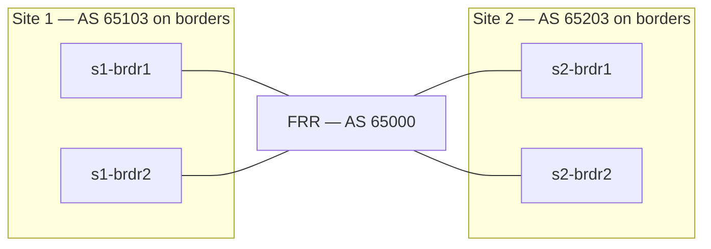

# FRR transport between the data centers

FRR provides IPv4 transport for the two EVPN/VXLAN fabrics. The Arista border
switches remain the EVPN gateways and terminate VXLAN. FRR exchanges IPv4
loopback routes with the borders using eBGP; it does not need tenant VRFs,
EVPN sessions, or VXLAN interfaces.



The established design is datacenter EVPN/VXLAN on AVD 6.4.0: `spine` and
`l3leaf` roles, leaf gateways, an eBGP underlay, an eBGP EVPN overlay, and
EVPN VRF services. The existing Containerlab topology supplies the cabling.
The DCI uses the default routing table to carry border Loopback0 addresses
for EVPN peering and the VXLAN source loopbacks for tunnel forwarding.

## Source of truth

Define the four border-to-FRR links in
[global_dc_vars.yml](global_vars/global_dc_vars.yml) under `l3_edge`. AVD allocates
the /31s and builds the EOS handoffs. FRR is an external peer and stays outside
the AVD fabric inventory.

| Border port | FRR port | Border address | FRR address |
| --- | --- | --- | --- |
| s1-brdr1 Ethernet4 | eth1 | 172.16.255.0/31 | 172.16.255.1/31 |
| s1-brdr2 Ethernet4 | eth2 | 172.16.255.2/31 | 172.16.255.3/31 |
| s2-brdr1 Ethernet4 | eth3 | 172.16.255.4/31 | 172.16.255.5/31 |
| s2-brdr2 Ethernet4 | eth4 | 172.16.255.6/31 | 172.16.255.7/31 |

These addresses describe the current pool and link IDs. The FRR generator reads
the actual allocated addresses from AVD outputs each time you build.

The border groups enable `evpn_gateway` in each site's `FABRIC.yml`. Their
remote EVPN peers use **Loopback0** (`10.250.2.7`/`10.250.2.8` from Site 1 and
`10.250.1.7`/`10.250.1.8` from Site 2). VXLAN source addresses come from the
separate `10.255.*` pools. Both sets of loopbacks need transport reachability.

## Generate configurations

Use the lab's AVD 6.4.0 environment, which supplies Python, PyYAML, Jinja2,
`pyavd`, and the matching `arista.avd` collection:

```bash
make build-dci
```

This builds both complete fabrics before running
[scripts/build_frr.py](scripts/build_frr.py). The script reads:

- `sites/*/intended/structured_configs/<border>.yml`: interface IPs, peer
  metadata, BGP ASNs, authentication, BFD, MTU, and loopback addresses.
- `clab/topology.clab.yml` and `clab/interfaces.json`: cabling and EOS interface
  names. The FRR management address is used only as its BGP router ID.

The script renders [templates/frr.conf.j2](templates/frr.conf.j2) into
`clab/intended/frr-core1.conf`. It rejects missing border outputs, cabling
mismatches, duplicate link subnets, and inconsistent FRR ASNs. Use
`make build-frr` to render again from existing AVD outputs; rebuild both sites
first whenever the AVD inputs change.

Use structured YAML as the integration boundary. It contains resolved AVD
intent and avoids parsing EOS CLI or maintaining a second FRR address plan.
AVD renders EOS configuration; the FRR template handles FRR syntax.

Each FRR inbound route map permits only the connected border's control-plane
and VXLAN source /32s. The outbound route map permits the union of those /32s.
There is no `redistribute connected`, so the management subnet and FRR handoff
subnets are not advertised. FRR keeps its default requirement for eBGP policy.

The existing IPv4 underlay peer group uses BGP authentication. The generator
uses AVD's `decrypt` filter to convert its EOS type-7 secret into the cleartext
form FRR requires. The generated file has mode `0600` and is ignored by Git.
Keep it local to the lab host. Changing an encrypted AVD password requires
rebuilding both sites and FRR together.

## Start or update the lab

Review the generated EOS and FRR configurations, then start the lab:

```bash
make start
make deploy-site-1 deploy-site-2
```

`make start` builds the DCI artifacts, then runs the existing Containerlab
deployment command. EOS nodes still load their management bootstrap configs;
the eAPI deployment installs their intended configurations. FRR loads its
generated `startup-config` directly. The native FRR kind enables IP forwarding
and starts `bgpd` and `bfdd`. This workflow uses the lab's pinned Containerlab
0.81.1 and FRR `containerlab-10.7.1` image.

For an already running lab, `make build-dci` only generates files. To apply
the new FRR configuration without restarting the fabric, preview and reconcile
it inside the existing FRR container:

```bash
make check-frr
make deploy-frr
make deploy-site-1 deploy-site-2
```

`check-frr` copies the generated config and runs `frr-reload.py --test`.
Inspect its output before running `deploy-frr`, which repeats the preview,
applies `--reload`, and saves the running configuration. Reloading reconciles removals as
well as additions; simply replaying CLI commands can leave stale neighbors.
Containerlab uses the generated startup file on subsequent deployments because
`enforce-startup-config` is enabled for FRR.

After reviewing the source inputs, use `make all` for the combined build and
deployment to the running lab. It builds both sites and FRR before applying
FRR and deploying each site's EOS configurations in sequence.

## Verify connectivity

On the Containerlab host:

```bash
docker exec frr-core1 vtysh -c 'show bgp ipv4 unicast summary'
docker exec frr-core1 vtysh -c 'show ip route bgp'
docker exec frr-core1 vtysh -c 'show bfd peers'
```

Expect four established BGP neighbors and routes to the border loopbacks.
On `s1-brdr1`, check the remote control-plane route, source reachability from
Loopback0, and inspect EVPN peering:

```text
show ip route 10.250.2.7
ping 10.250.2.7 source Loopback0
show bgp evpn summary
show interfaces Vxlan1
```

Check the actual remote VXLAN source address from the generated Site 2
configuration as well. MLAG peers can share a VXLAN source address.
Then run the existing site validation playbooks:

```bash
make validate-site-1 validate-site-2
```

The checked-in tenant and server definitions are commented out as workshop
exercises. Enable the required services and endpoints before testing traffic
between hosts. EVPN peering and loopback reachability alone do not establish
tenant connectivity. This transport design preserves the existing EVPN L2/L3
gateway intent; direct tenant routing through FRR would require VRF handoffs
and a different design.

The lab uses a 1500-byte transport MTU. VXLAN adds encapsulation overhead;
use smaller tenant packets or raise the MTU consistently along the entire
transport path before testing full-size tenant frames. The single FRR node
is also a shared point of failure despite having four border links.

References: [AVD 6.4 L3 edge model](https://avd.arista.com/6.4/ansible_collections/arista/avd/roles/eos_designs/docs/input-variables.html#l3-edge)
and [Containerlab FRR kind](https://containerlab.dev/manual/kinds/frr/).
