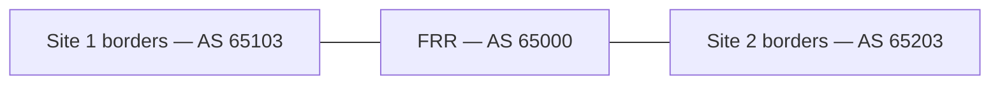

# Preconfigured FRR transport

`frr-core1` starts with a complete IPv4 DCI configuration from
[clab/init-configs/frr-core1.conf](clab/init-configs/frr-core1.conf). Students
configure the Arista borders with AVD 6.4.0 as they progress through the lab.
FRR exchanges IPv4 routes with the borders using eBGP. The Arista borders
terminate EVPN/VXLAN and provide the tenant gateways.



## Start the lab

```bash
make start
```

Containerlab loads the checked-in FRR startup config and starts `bgpd` and
`bfdd`. The native FRR kind enables IP forwarding. EOS devices load their
management bootstrap configs, ready for students to build and deploy with AVD.
No FRR build or deployment playbook is required.

The topology uses `enforce-startup-config: true` for FRR, so redeploying the lab
reloads the checked-in configuration. The lab uses Containerlab 0.81.1 and the
FRR `containerlab-10.7.1` image.

## Handoff contract

| Border port | FRR port | Border address | FRR address | Border ASN |
| --- | --- | --- | --- | --- |
| s1-brdr1 Ethernet4 | eth1 | 172.16.255.0/31 | 172.16.255.1/31 | 65103 |
| s1-brdr2 Ethernet4 | eth2 | 172.16.255.2/31 | 172.16.255.3/31 | 65103 |
| s2-brdr1 Ethernet4 | eth3 | 172.16.255.4/31 | 172.16.255.5/31 | 65203 |
| s2-brdr2 Ethernet4 | eth4 | 172.16.255.6/31 | 172.16.255.7/31 | 65203 |

FRR uses AS 65000 and router ID `192.168.0.250`. Its four neighbors have BFD
and the lab BGP authentication key matching the EOS `IPv4-UNDERLAY-PEERS`
peer group in [global_dc_vars.yml](global_vars/global_dc_vars.yml).

Inbound route maps accept each border's Loopback0 and VXLAN source /32s.
The outbound route map permits the union of those routes. There is no
`redistribute connected`, so FRR does not advertise the management subnet or
the handoff subnets.

The six permitted routes are `10.250.1.7/32`, `10.250.1.8/32`,
`10.250.2.7/32`, `10.250.2.8/32`, `10.255.1.7/32`, and `10.255.2.7/32`.
Loopback0 addresses support EVPN peering. The separate `10.255.*` addresses
support VXLAN forwarding; each border MLAG pair shares a VXLAN source address.

The startup config and the commented AVD handoff example form a fixed lab
address plan. If you change addresses, ASNs, authentication, or gateway
loopbacks, update the FRR startup file and the matching AVD inputs together.

## Student checkpoints

1. **Before Day 0, Step 5:** FRR has its interfaces and neighbors configured,
   but BGP sessions are not established because the EOS handoffs are not yet
   configured. This is the expected starting state.
2. **After Step 5:** Students enable `l3_edge`, then build and deploy both sites
   with Ansible. Expect four established FRR BGP sessions, BFD peers up, and
   routes to the border Loopback0 and VXLAN source addresses.
3. **After Step 6:** Students enable the Arista EVPN gateways. Expect remote
   EVPN sessions and connectivity between the configured tenant hosts.
   FRR continues to carry IPv4 transport routes.

Follow [Day 0, Step 5](day0.md#step-5---connect-sites-to-dci-network) for the
handoff exercise and Step 6 for the EVPN gateway exercise.

On the Containerlab host:

```bash
docker exec frr-core1 vtysh -c 'show bgp ipv4 unicast summary'
docker exec frr-core1 vtysh -c 'show ip route bgp'
docker exec frr-core1 vtysh -c 'show bfd peers'
```

Compare these with `show ip bgp summary` and `show ip route` on `s1-brdr1`.
The same BGP session appears on both vendors, with local and remote ASNs
reversed. Check `ping 10.250.2.7 source Loopback0` for transport reachability,
then `show bgp evpn summary` for the overlay.

The lab uses a 1500-byte transport MTU. VXLAN adds encapsulation overhead;
use smaller tenant packets or raise the MTU throughout the transport path
before testing full-size tenant frames.

Reference: [Containerlab FRR kind](https://containerlab.dev/manual/kinds/frr/).
